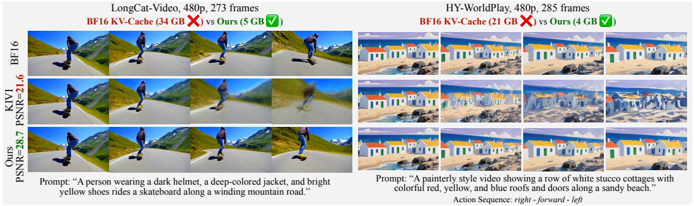
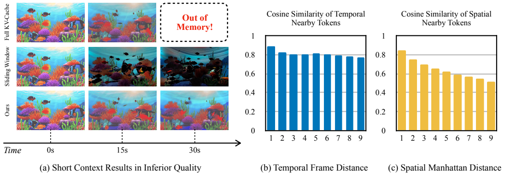
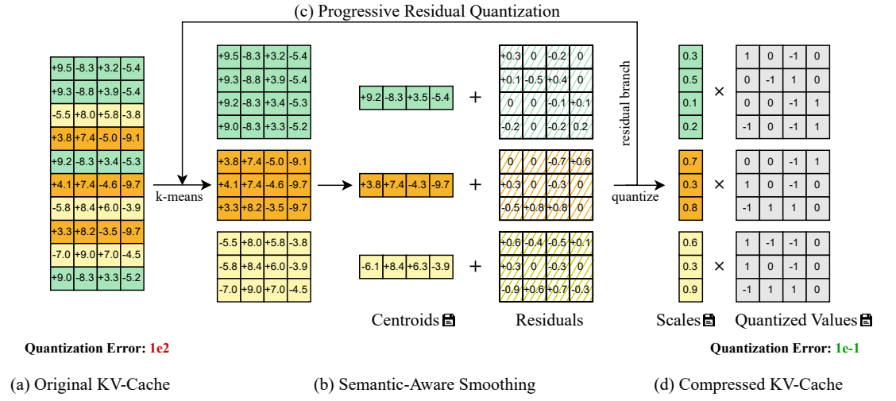

# Quant VideoGen：2 比特 KV Cache 量化实现视频生成

Diffusion models · 阅读日期 2026 年 11 月 16 日

[论文原文（arXiv v5）](https://arxiv.org/abs/2602.02958v5) · [官方代码](https://github.com/svg-project/Quant-VideoGen)

## 引言

视频扩散模型发展迅速，但是主流的双向注意力视频扩散模型在实际场景中基本局限于生成 5–10 秒的视频，难以满足更多场景。

核心原因在于生成过程的扩展性欠佳。双向视频扩散模型在推理的每一步去噪中，token 都会关注过去和未来帧。只有在整个窗口去噪完毕后，较早的帧才能安全输出。自回归视频扩散带来了范式转变。通过施加时间因果约束，再将计算分摊到各次生成中，输出帧只依赖已保留的历史，因此一旦生成就可以逐步提交并以流式方式输出。这个转变打开了双向注意力难以支持的应用场景。

自回归视频模型也引入了系统与算法耦合的问题，即 **KV Cache 的显存占用**。

*图 1. QVG 的生成结果与 KV Cache 显存占用对比。*

这篇论文通过量化 KV Cache 来解决显存瓶颈。直接将 LLM 推理服务中的 KV Cache 量化方法移植到视频扩散模型，会使生成质量严重下降。根本原因是激活值的统计特性不同。视频模型在 token 和通道两个维度上的数值分布不均匀，使得面向 LLM 的假设难以成立。于是，这篇论文提出了 Quant VideoGen（QVG），一个无需训练的 KV Cache 量化框架。

QVG 的关键观察是，视频模型的 KV Cache 具有很强的时空冗余。在空间上或时间上相邻的 token，往往在潜空间中的数值也很相似。

基于这个观察，作者提出了**语义感知平滑**和**渐进式残差量化**。前者在量化前根据 token 在潜空间中的相似性分组，缓解数值分布的不均匀性。后者分多个阶段压缩残差张量，降低量化误差。

## 研究动机

### KV Cache 是自回归视频生成的瓶颈

在自回归视频扩散模型中，KV Cache 随着潜空间 token 的数量线性增长。在长时、高分辨率生成中，它很快成为显存的主要占用项。对于一个具有 $L$ 层、隐藏维度为 $d$ 的模型，如果视频的潜空间尺寸为 $H\times W$，时间长度为 $T$，存储 KV Cache 需要的显存为

$$
\mathrm{Mem}_{\mathrm{KV}}
= 2 \cdot L \cdot (HWT) \cdot d \cdot \mathrm{Byte}_{\mathrm{BF16}}.
$$

其次，短上下文会降低生成质量。现有自回归视频系统在默认推理配置中采用固定长度的上下文窗口。这会缩小模型的工作记忆，因此作者希望通过降低 KV Cache 的量化位宽来缓解显存瓶颈。

*图 2. 左图对比上下文策略，中图和右图展示时间与空间上相邻 token 的相似度。*

### 视频 KV Cache 难以量化

量化将浮点数映射为低比特值，从而节省显存。论文考虑位宽为 $b$ 的按组对称整数量化。量化和反量化过程表示为

$$
X_{\mathrm{INT}}, S_X = Q(X_{\mathrm{BF16}}),
\qquad \hat{X} = S_X \cdot X_{\mathrm{INT}}.
\tag{1}
$$

其中

$$
X_{\mathrm{INT}} =
\operatorname{round}\left(\frac{X_{\mathrm{BF16}}}{S_X}\right),
\qquad S_X = \frac{\max |X_{\mathrm{BF16}}|}{2^{b-1}-1}.
\tag{2}
$$

对于量化组中的任意元素 $x$，量化误差满足

$$
|x-\hat{x}| =
S_X\,\operatorname{RoundErr}\left(\frac{x}{S_X}\right)
\leq \frac{S_X}{2},
\qquad \operatorname{RoundErr}(u) = |u-\operatorname{round}(u)|.
\tag{3}
$$

当归一化舍入误差的分布相近时，期望绝对误差随缩放因子成正比。

$$
\mathbb{E}[|x-\hat{x}|] \propto S_X.
\tag{4}
$$

因此，缩放因子越大，量化误差的上界就越大。离群值可能造成较大的缩放因子。这个效应会在自回归视频生成中进一步加剧。

### 视频 KV Cache 具有高度冗余

**视频 token 的时空冗余。** 视频内容在空间和时间上都有很强的冗余。如图 2(b) 所示，在固定空间位置，相邻帧的 token 往往高度相似。图 2(c) 中，空间上相邻的图块也会映射为高度相似的潜空间 token。

**视频的渐进式编码。** 视频具有内在的渐进式结构，适合用残差表示。借助时间连贯性，大多数帧可以先在粗粒度上预测，得到整体布局和主要运动，再通过残差进一步加入精细的细节。

## 方法

*图 4. QVG 框架概览。(a) 原始张量分布不规则，难以量化。(b) 语义感知平滑将相似 token 分组，并减去各组的质心，使残差易于量化。(c) 渐进式残差量化通过迭代应用语义感知平滑，进一步降低量化误差。(d) 最终的残差张量更易量化，量化误差也小得多。*

### 语义感知平滑

由于视频 token 具有很强的时空冗余，语义感知平滑利用这种冗余形成语义相似的组，减少数值幅度，从而实现准确的低比特量化。

**基于语义分组。** QVG 逐块处理 KV Cache。考虑一个含有 $N$ 个 token 的块，例如 $N=HWT_c$，其中 $H$ 为高度，$W$ 为宽度，$T_c$ 为潜空间帧数。令 $X\in\mathbb{R}^{N\times d}$ 表示相应的 KV Cache，$d$ 为注意力头的维度。

以这 $N$ 个 token 的隐藏表示为依据，用 *k*-means 算法将它们划分为 $C$ 组，得到一组互不相交的组 $\mathcal{G}=\{\mathcal{G}_1,\mathcal{G}_2,\ldots,\mathcal{G}_C\}$。每组 $\mathcal{G}_i$ 包含隐藏表示相似的 token。如原论文图 3(b) 所示，同组 token 的数值分布明显更加均匀。用 $C_i\in\mathbb{R}^d$ 表示每组的均值，即质心。

**减去质心计算残差。** 对于每一组 $\mathcal{G}_i$，从组内每个 token 减去质心以平滑分布，得到以下残差。

$$
R_i = X_{\mathcal{G}_i}-C_i,
\qquad R_i\in\mathbb{R}^{|\mathcal{G}_i|\times d}.
\tag{5}
$$

其中，$X_{\mathcal{G}_i}$ 指由 $\mathcal{G}_i$ 中的 token 构成的矩阵。在位宽固定时，量化误差的上界与量化组内的最大绝对值成正比。经过 *k*-means 聚类后，这些较大的值预计为组内 token 所共有，由 $C_i$ 捕捉。因此，如原论文图 3 所示，减去质心后，残差的数值范围大幅缩小，量化误差也随之减小。

### 渐进式残差量化

**渐进细化残差。** 设 $R^{(0)}=X$ 为初始输入，$T$ 为总阶段数，每一阶段都使用相同的组数 $C$。在第 $t$ 阶段，对上一阶段的残差张量应用语义感知平滑，得到新的残差张量。

$$
R^{(t)}, \mathbf{C}^{(t)}, \pi^{(t)}
= \operatorname{SA\text{-}Smoothing}(R^{(t-1)}, C).
$$

经过 $T$ 个阶段后，得到最终残差张量 $R^{(T)}$。把最终输出量化成低比特表示

$$
X_{\mathrm{INT}}, S_X = Q(R^{(T)})
$$

并将其存入全局显存。还要保存 $1\leq t\leq T$ 的所有质心 $\mathbf{C}^{(t)}$ 和分配向量 $\pi^{(t)}$。各阶段的浮点残差 $R^{(t)}$ 都作为中间结果丢弃。

每一阶段都对剩余残差重新聚类并减去质心，最后对剩余残差执行整数量化。这样可以逐步建模从粗粒度语义结构到细粒度变化的信息，降低量化误差。完整流程见图 4。

**反量化过程。** 在单阶段语义感知平滑中，给定存储的质心 $\mathbf{C}$ 和分配向量 $\pi$，索引为 $i$ 的 token 通过将其对应的质心加回残差来重建。令 $R_i$ 表示残差张量的第 $i$ 行，按 token 索引写作

$$
\hat{X}_i = R_i + C_{\pi_i}.
\tag{7}
$$

对于渐进式残差量化，从第 $T$ 阶段向第 1 阶段迭代执行这一操作。从量化后的 $X_{\mathrm{INT}}$ 和 $S_X$ 开始，先做反量化，然后依次恢复 $\hat{X}^{(T-1)},\ldots,\hat{X}^{(0)}$，其中 $\hat{X}^{(0)}$ 是最终重建的张量。这个过程恰好按逆序重放渐进量化的各个阶段。

### 算法优化

**流式质心缓存加速 *k*-means。** 为加速聚类，作者提出质心缓存方法，利用前一个视频块的分配方案初始化新视频块的质心。这一策略将 *k*-means 的开销降至原来的约三分之一。

**反量化内核。** 作者实现了一个融合内核，用于反量化张量，并将渐进式残差量化各阶段中分配到的质心加回。中间结果存放在寄存器中，避免反复从全局显存读取。

## 总结

**Quant VideoGen（QVG）用更少的显存保留更长的视频生成历史，从而缓解长视频中的画面漂移。**

- **问题**　自回归视频生成的 KV Cache 随历史增长。显存不足时，模型只能截断历史，主体外观和场景布局更容易漂移。
- **方法**　利用视频的时空冗余，把相似的 token 聚类并减去质心。可以对残差重复这个过程，最后只对剩余的小幅值残差做 2 比特量化。整个过程无需重新训练。
- **结果**　主实验中，KV Cache 最高压缩至原来的约 **1/7**，端到端延迟增加 **1.5%–4.3%**。在 Self-Forcing 的 1,400 帧（约 90 秒）实验中，QVG 的 VBench 图像质量与 BF16 参考相当。

## 图源

图 1、图 2 和图 4 来自 Haocheng Xi 等人的 *Quant VideoGen: Auto-Regressive Long Video Generation via 2-Bit KV-Cache Quantization*（2026），保留了原图，图注为中文说明。[论文原文](https://arxiv.org/abs/2602.02958v5) · [CC BY 4.0](https://creativecommons.org/licenses/by/4.0/)
